<!-- Profile README for github.com/brianshand561 -->

 

 

&nbsp;&nbsp;&nbsp;&nbsp;

 

> **I run the platform that hundreds of engineers ship on.** At a Fortune 200 enterprise I own large-scale Kubernetes and AWS infrastructure: self-service platforms, CI/CD systems, and governance tooling that make shipping software secure, fast, and boring in the best way. Before tech I spent a decade founding and running a carbon fiber manufacturing company, so I think about P&L, throughput, and process as much as I think about pods.

 

 

## 🧰 Tech stack

  

 

 

## 🎓 Certifications

 

## 📈 Activity

<picture>
  <source media="(prefers-color-scheme: dark)" srcset="https://raw.githubusercontent.com/brianshand561/brianshand561/output/github-snake-dark.svg" />
  <source media="(prefers-color-scheme: light)" srcset="https://raw.githubusercontent.com/brianshand561/brianshand561/output/github-snake.svg" />
  
</picture>

  

 

**Open to conversations about platform engineering, Kubernetes at scale, and making CI/CD boring.**

<a href="http://www.linkedin.com/in/brianshand561">LinkedIn</a> · <a href="mailto:brianshand561@gmail.com">Email</a>

